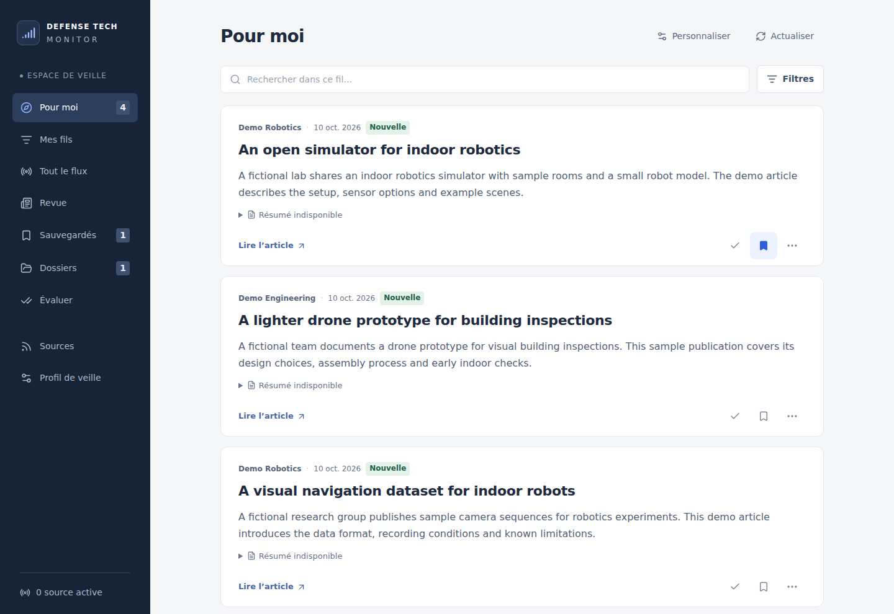

# Defense Tech Monitor

A personal news reader for following drones, robotics and defense technology.

I'm building it to keep the sources I follow in one place, sort through new
publications and save the ones I want to come back to. Each item keeps its
original source and link, so I can go straight to the article.

**Still in development, before V1.** The current prototype brings together
collection, filtering and reading tools. The interface and source coverage are
still being worked on.



_The current interface is in French. This screenshot uses fictional publications
in a separate demo database._

## What's there so far

- **Collect publications** from RSS/Atom feeds and supported news websites.
  Collection can run manually or on a schedule while the server is running.
- **Build a personal feed** with keywords, exclusions and feedback. Optional
  Jev classification adds topic feeds with their own written briefs.
- **Read and organize** with search, filters, bookmarks, folders and grouping
  for similar announcements.
- **Catch up with a review** of recent imports, grouped by topic and available
  as a Markdown download.
- **Share a reading page** through the included hosting setup, while keeping
  personal settings and administration behind a password.

RSS and website collection, keyword filtering and reading work without an API
key. X collection, Jev classification and French AI summaries are separate,
optional integrations. Each needs its own credentials and a positive budget cap.
Summaries are generated only when requested; saved summaries can be read again
without a new call.

## Where it stands

This is one person's monitoring workspace. Source coverage depends on the feeds
and supported websites, and the collected text can be an excerpt. A source can
fail or change its page structure, so the app keeps collection status and errors
visible.

Keyword matches, AI scores and grouped announcements help organize the reading.
They do not verify an article's claims. The public reading page shows all collected
publications, independently of the personal feed, while keeping personal settings,
folders and reading states out of it.

[How to use the prototype](docs/usage.md).

## Run locally

Requires **Node.js 24.15 or later** and npm. The repository's `.nvmrc` selects Node 24.

```sh
git clone https://github.com/victormonnot/defense-tech-monitor.git
cd defense-tech-monitor
npm ci
npm run dev
```

Open `http://127.0.0.1:3000`. The app creates a local SQLite database at
`data/monitor.sqlite`. No environment file is needed for the default setup.

The feed starts empty. Use **Actualiser les sources** to collect the configured
sources, or run this in a separate terminal:

```sh
npm run collect
```

Collection contacts the configured sources. Automatic collection is off by
default. Optional settings are listed in [`.env.example`](.env.example) and the
[development guide](docs/development.md).

## Development

Built with Next.js, React, TypeScript and SQLite. Collection and classification
run on the server, which also stores reading state.

```sh
npm run format:check
npm run check
npm test
npm run build
```

`check` checks TypeScript. Tests cover collection, storage, selection, optional
providers and the separation between public reading and private administration.
GitHub Actions runs these checks and the production build.

- [User guide](docs/usage.md)
- [Development and provider setup](docs/development.md)
- [Coolify deployment and backups](deploy/README.md)
- [My portfolio](https://victormonnot.com)
