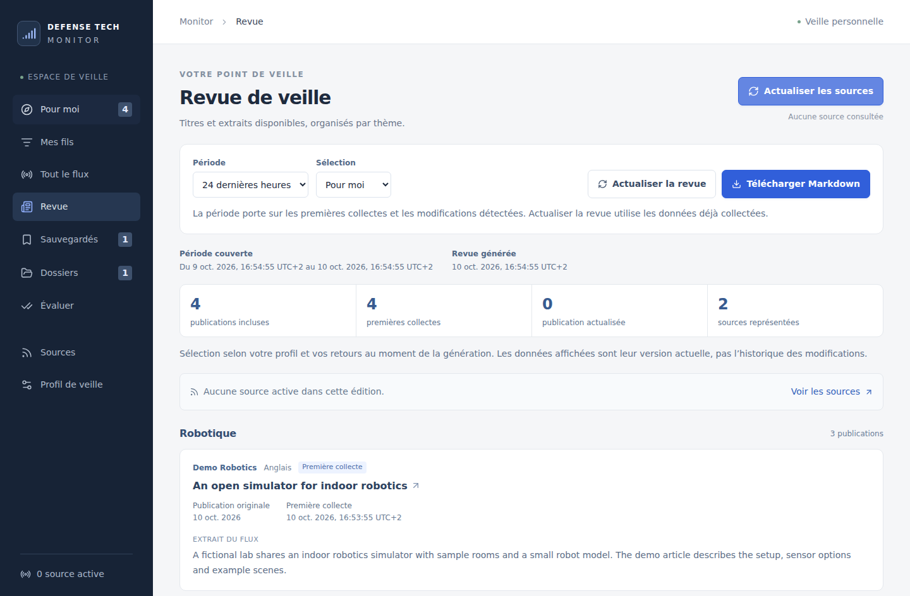

# Usage guide

Defense Tech Monitor is a personal project still in development before a usable
V1. This guide describes the prototype's current behavior. Follow the
[development guide](development.md#local-setup) to run it locally.

The interface uses French labels. Website and RSS/Atom collection and keyword
selection work without API keys. X collection, Jev selection, and French
summaries are separate optional services with separate budgets.

## Finding your way around

| View                 | What it contains                                                                                          |
| -------------------- | --------------------------------------------------------------------------------------------------------- |
| **Pour moi**         | Your general selection, using keyword rules or optional Jev scores, with your relevance feedback applied. |
| **Mes fils**         | Topic feeds with their own written briefs and optional Jev selection.                                     |
| **Tout le flux**     | All collected publications, including those outside your personal selection.                              |
| **Revue**            | A themed edition covering recent collection activity, with a Markdown download.                           |
| **Sauvegardés**      | Bookmarked publications.                                                                                  |
| **Dossiers**         | Named folders for organizing publications.                                                                |
| **Évaluer**          | Publications to judge and keyword rule mistakes to review.                                                |
| **Sources**          | Source configuration, collection status, errors, and scheduling.                                          |
| **Profil de veille** | Keywords, exclusions, text scope, and optional provider status.                                           |

Reading views have search and a collapsible **Filtres** panel for source,
language, topic, format, and collection changes. Active filters remain visible
when the panel is closed. Read and bookmark controls are available on each card.
The **…** menu reveals folders, feedback, content provenance, scores, and related
publications. Opening these controls does not mark an article as read or request
a summary.

Search ignores case, Latin accents, and extra spaces. Every search term must
appear, in any order: `defense drone` also finds `Drone de défense`. Personal
views search titles, excerpts, sources, and topics; public search also includes
available French summaries instead of personal topic tags.

In a hosted installation, the public page offers collected publications, source
filtering, search, and existing French summaries. It contains all collected
publications, independently of the personal selection. Personal settings,
folders, feedback, reading states, and provider usage belong to the protected
`/admin` workspace. Public reads do not request collection or generate summaries.
See the [deployment guide](../deploy/README.md) for that optional setup.

## Setting your keyword profile

Open **Profil de veille** and enter comma-separated terms under **Sujets et
mots-clés à suivre** and **Mots-clés à exclure**. **Correspondances minimales**
sets how many distinct keywords must match. One exclusion is enough for the
rules to reject a publication; explicit positive feedback can still retain it.
Include terms in the languages your sources use. Rules have no general
understanding of synonyms or translation.

Under **Texte utilisé pour la sélection**, choose:

- **Tout le texte collecté**, the default, which can include text beyond the
  displayed excerpt.
- **Titre et extrait disponible**, which uses the title and up to the first 480
  available characters. A publication with no excerpt uses its title alone.

The same scope applies to topic tags and optional Jev requests for every feed.
Changing it does not download more content. A shorter scope may avoid incidental
mentions but can also miss useful matches.

**Prévisualiser les changements** compares the draft with the saved profile,
showing publications entering or leaving the selection and changes on existing
judgments. It includes general feedback, excludes Jev, and makes no provider
request. Editing the draft or changing collected data invalidates the preview.
Use **Enregistrer mon profil** to apply the profile explicitly. Keyword changes
do not rewrite your feed briefs.

## Correcting selection

Publication feedback takes effect immediately:

- **Pertinent** retains a publication even below the active selection threshold.
- **Hors sujet** and **Déjà vu** remove it from the relevant personal feed.
- Clicking the selected feedback again clears it and restores normal selection.

Feedback preserves the article and its read, bookmark, and folder states. It
does not train a model or edit keywords automatically. **Déjà vu** is a selection
decision, separate from marking a publication as read.

**Évaluer** shows publications individually, including items outside **Pour
moi**. **À évaluer** finds unjudged items, **Manqués par les règles** finds rule
misses, **Retenus mais hors sujet** finds unwanted rule matches, and **Tous les
retours** shows your judgments. These filters compare feedback with the raw
keyword decision before corrections. A corrected publication can therefore
remain listed as a rule miss.

Precision is the share of judged rule matches marked relevant. Recall is the
share of publications marked relevant that the rules would select. They describe
your judged sample only. **Déjà vu** supplies no relevance label. Neither these
figures nor Jev confidence measures source reliability or verifies a claim.

## Creating topic feeds with Jev

Under **Mes fils**, choose **Nouveau fil** and an editable **Drones**, **Ukraine
news**, or **Startups** preset, or start with **Personnalisé**. Each feed has its
own brief, exclusions, interest threshold, confidence threshold, and sorting.
**Personnaliser** opens these settings on a feed without losing an unsaved draft
when the panel is closed.

Jev evaluates fit to a written brief and classifies editorial type through the
TypeSafe API. It does not generate summaries. New databases start with Jev
disabled; a custom feed does not bypass missing configuration or the global
mode. Configure a key and positive budget as described in
[Jev setup](development.md#jev-selection-optional), then explicitly apply a mode
under **Profil de veille**:

| Mode                       | Selection behavior                                                                                                                                                 |
| -------------------------- | ------------------------------------------------------------------------------------------------------------------------------------------------------------------ |
| **Désactivé**              | Stops new Jev calls for all feeds. **Pour moi** uses keywords; custom feeds retain valid cached decisions.                                                         |
| **Comparer aux règles**    | Enabled feeds can be analyzed in the background. Custom feeds use their scores; **Pour moi** continues to use keyword rules.                                       |
| **Utiliser dans Pour moi** | The general feed uses its thresholds and falls back to keywords for missing or uncertain scores. Custom feeds require usable scores or explicit positive feedback. |

Interest ranges from 0 to 3 and confidence from 0 to 100%. Starting thresholds
of 1.5 and 60% are editable defaults, not measured accuracy guarantees. A brief
announcement may fit a feed without containing detailed engineering content.
Relevance sorting puts explicit positive feedback first, then usable scores.
Date sorting uses publication date, or collection date when it is missing.
Collection-change filters keep their own activity ordering.

Reading, bookmarks, folders, and change acknowledgements are shared across
feeds. Feedback inside a custom feed applies only to that feed; general feedback
belongs to **Pour moi**. **Archiver** preserves a custom feed's settings, scores,
and feedback while stopping new analyses. Use **Restaurer** to bring it back.
The general feed cannot be renamed or archived.

Threshold and sort previews use existing scores locally, before feedback, and
make no provider calls. Saving changed instructions or exclusions invalidates
that feed's old scores and queues new work when analysis is enabled. Changed
article content or shared text scope can also require new scores. Renaming a
feed or changing thresholds, sorting, feedback, or reading state does not
invalidate its scores. Pausing a feed stops subsequent requests; a request
already in progress may finish.

Enabled analyses run in the background while the server is running and share
one monthly Jev budget. Opening a page, polling, or drafting and previewing
settings does not itself request paid work. Classification sends the title,
language, selected available text, provenance, and feed instructions and
exclusions to TypeSafe. Metadata-only items send no body. Failures pause
processing; an explicit retry may incur another charge. The comparison with
keyword rules is a disagreement view, not an accuracy benchmark.

## Saving, filing, and grouping

Bookmarks appear in **Sauvegardés**. In **Dossiers**, create or rename folders,
then use **Classer** on a publication to place it in one or more folders. Folder
membership is independent of selection, feedback, bookmarks, and read state.
Search and filters also work inside a folder; its total count still includes
all members. Folder names are limited to 80 characters and must be unique,
including archived folders, after case and spacing normalization.

Archiving a folder preserves its contents for consultation. It cannot receive
new publications until reactivated, but existing assignments can be removed.
Bookmarks, folders, and their assignments persist across collection and server
restarts.

Enable **Regrouper les annonces similaires** in **Filtres** to reduce repeated
coverage. A group keeps one full card and expandable members with their own
title, original link, date, excerpt, and controls. Reading, saving, filing, or
rating one member never changes the others. Grouping applies after the current
view and filters, so it cannot bring excluded sources or publications back.

Groups require strict title and available-text matches, the same known
language, and publication dates within seven days. Missing dates, different
details, and incomplete text can prevent a match. Weaker matches may appear as
comparison suggestions. Use **Conserver séparé** to keep a publication outside
automatic groups, and **Rétablir le regroupement** to reverse that choice.
Grouping does not merge records, confirm an announcement, or establish
independent corroboration.

## Catching up on collection changes

In **Filtres**, **Nouvelles** means first collected since that publication was
last acknowledged, even if its publication date is old. **Actualisées** means
its collected data changed after acknowledgement. These markers describe the
local collection, not whether an event or claim is new.

**Valider les nouveautés affichées** acknowledges pending publications matching
the current view, search, and filters, including members inside displayed
groups. Each batch is limited to 200 publications; repeat when more remain.
Hidden publications stay pending. Acknowledgement does not change read,
bookmark, folder, or feedback state, and opening the page acknowledges nothing.
If collection changes a publication during review, the newer revision remains
pending. Identical imports do not create updates.

## Reading and exporting a review

_The prototype with fictional publications in a separate demo database.
Collection is disabled for this capture._

Open **Revue**, choose **24 dernières heures** or **7 derniers jours**, then
**Pour moi** or **Tout le flux**. The period uses first-collection and
collected-update timestamps. An old article imported today can therefore enter
today's review. Read, bookmark, and acknowledgement states do not remove items.

The edition stays fixed while you read. **Actualiser la revue**, changing the
period or scope, or reopening the view creates a fresh edition from collected
data. **Actualiser les sources** runs collection separately. Background changes
show an update notice without replacing the edition.

Each edition contains at most the 100 most recently collected or updated
publications in its window. Omitted counts are shown; topic and publication
counts describe the included items. Each publication has one primary topic,
and grouping only uses included members. Source coverage notices cover all
active sources, including errors and sources not checked during the period.

**Télécharger Markdown** downloads the displayed edition locally, including
original links, source excerpts, provenance, coverage notices, and omissions.
It uses source excerpts even when a French summary exists. Viewing, refreshing,
and exporting a review changes no personal state and requests no AI generation.
Reviews use the latest collected version available when created, do not
reconstruct old revisions, and are not stored as editions in the database.
Keep the downloaded file to retain an edition.

## Managing sources and collection

The initial sources in [config/sources.json](../config/sources.json) are
Ukraine's Arms Monitor and Militarnyi through RSS, plus Brave1 and Defender
Media through dedicated English public-page connectors. They are seeded on
first launch; editing that file does not overwrite an existing database.

Under **Sources**, enter a source name and website. Brave1 and Defender Media
are recognized automatically. Other websites need an RSS/Atom feed advertised
on the page, or a feed URL you supply. Failed feed discovery does not mean a
site has stopped publishing. **Modifier** edits the name, feed URL, or language;
the website address identifies the source and stays read-only. Saving preserves
its enabled state; **Annuler** discards the form.

Use **Actualiser les sources** or `npm run collect` to run collection. Source
cards show the method, collection address, status, and errors. Disabling a
source prevents subsequent requests from starting. Failures retain previously
collected articles and do not stop the remaining sources.

Brave1 and Defender Media each read one listing page, then retrieve supported
public article text in bounded batches. They do not follow listing pagination
or import the full archive. Further collections continue pending article
retrieval. **Sources** shows available, pending, and unsuccessful retrieval
counts. A temporary retrieval failure keeps the last successful text. Changes
preserve personal states but can invalidate cached analyses and summaries.
Enabled Jev analysis may then run again; summaries stay on demand.

Collection respects robots.txt and applies request limits and destination
checks. It does not send account cookies or unlock subscriber content. Website
changes can break extraction. See [collection details](development.md#sources-and-collection)
for limits, cache intervals, and supported retrieval behavior.

### Automatic collection

Automatic collection is off by default. Under **Sources**, choose a **Fréquence**
from 15 minutes to 24 hours and select **Activer la collecte automatique**. The
first run becomes due immediately. The panel shows the next run and the latest
manual, scheduled, or command-line outcome, including source failures.

Keep `npm run dev` or `npm start` running. Closing the browser tab does not stop
collection, but stopping the server or sleeping the computer suspends it. An
overdue schedule runs once on restart instead of replaying missed intervals.
No operating-system task is installed.

**Mettre en pause** prevents future scheduled runs; a current run finishes.
Changing frequency schedules the next run from the change time. After a run
finishes, the next one uses its completion time. Manual collection remains
available while paused, and overlapping runs are prevented. The default
15-minute minimum between checks of a source is independent of this schedule.

A visible dashboard refreshes its data every 15 seconds and when you return to
the tab, preserving filters and unsaved drafts. This does not acknowledge new
publications. Only the latest run outcome is retained, not an unlimited history.

### Optional X accounts

Add a public account under **Sources** using an `@handle` or X profile URL.
Adding or editing it makes no lookup or paid request. A manual, scheduled, or
command-line collection can make paid reads once a Bearer Token and positive
X budget are configured. Keep collection paused or the cap at zero until ready;
see [X setup](development.md#x-accounts-optional).

The first successful import reads one page of up to 10 recent posts, excluding
replies and reposts. Later collections read newer posts, at most 10 per account
per run, with saved cursors to continue a backlog. This is not an exhaustive
archive import. The connector imports available text and original links. It
does not download media, expand threads, fetch linked article pages, or
synchronize later edits and deletions.

X posts use the same read, bookmark, folder, and optional Jev controls as other
publications. **Sources** shows X's separate monthly estimate. A provider
spending limit in the X console is separate from this application's local cap.

## Optional French summaries

Configure OpenAI and a positive summary budget using
[summary setup](development.md#french-summaries-optional). Configuration alone
does not generate anything. Use **Résumer en français** on an eligible
publication to request a short French summary of its available text. It sends
the title, source name, language, provenance, and available text to OpenAI.
This integration is independent of Jev.

Metadata-only publications and texts shorter than 400 characters are ineligible.
Longer text can still be insufficient. A summary may describe an excerpt, not
the complete article, and does not verify claims. Original titles, excerpts,
and source links remain available. A cached summary replaces the preview
excerpt with an AI label; the source excerpt remains under article options.

Valid summaries are cached across feeds. Changed source input or summary model
makes the previous result inapplicable; feedback, feed settings, and reading
state do not regenerate it. Reading and polling make no generation requests.
After a failure, **Réessayer le résumé** is an explicit new attempt. There are
no automatic retries.

Jev, summaries, and X each have a separate local monthly spending guard, defaulting
to zero. Failed or interrupted requests with uncertain billing can retain
reserved charges, including after a retry. These estimates cover this database,
not other applications or provider account balances. Provider configuration,
rates, and accounting details are in the [development guide](development.md).

## Understanding the available content

Article options identify provenance as **Texte fourni par le flux**, **Extrait
de la page de publications**, **Extrait de la page publique de l’article**,
**Texte publié sur X**, or **Titre et métadonnées uniquement**. These labels
describe what was collected, not the truth of its claims. Publication dates
remain separate from collection dates; unknown publication dates stay unknown.

Feed and extracted article text is limited to 20,000 characters and may be
incomplete. Personal dashboard previews show up to 400 characters; stored
excerpts and the public page can show up to 480. Stored article bodies are not
exposed by the API or republished in full. Metadata-only items have no excerpt or
generated summary. The prototype does not bypass paywalls, transcribe videos,
provide exhaustive archive imports, send alerts, or offer audio.

Personal data lives in the application's SQLite database. For local backups,
stop the application and copy `data/`; hosted backup and restore steps are in
the [deployment guide](../deploy/README.md).
